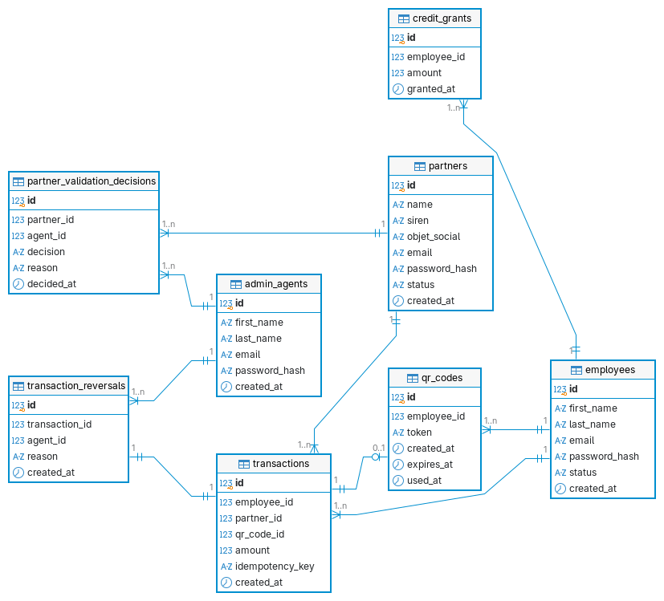

# Schéma de la base de données

## Tables et cardinalité



## Index

| Table | Nom de l'index | Colonne(s) | Type | Unique ? | Origine |
|---|---|---|---|---|---|
| employees | employees_pkey | id | btree | oui | PK (implicite) |
| employees | employees_email_key | email | btree | oui | UNIQUE (implicite) |
| partners | partners_pkey | id | btree | oui | PK (implicite) |
| partners | partners_email_key | email | btree | oui | UNIQUE (implicite) |
| partners | idx_partners_status | status | btree | non | explicite |
| admin_agents | admin_agents_pkey | id | btree | oui | PK (implicite) |
| admin_agents | admin_agents_email_key | email | btree | oui | UNIQUE (implicite) |
| partner_validation_decisions | partner_validation_decisions_pkey | id | btree | oui | PK (implicite) |
| partner_validation_decisions | idx_partner_validation_decisions_partner_id | partner_id | btree | non | explicite |
| credit_grants | credit_grants_pkey | id | btree | oui | PK (implicite) |
| credit_grants | idx_credit_grants_employee_id | employee_id | btree | non | explicite |
| qr_codes | qr_codes_pkey | id | btree | oui | PK (implicite) |
| qr_codes | qr_codes_token_key | token | btree | oui | UNIQUE (implicite) |
| qr_codes | idx_qr_codes_employee_id | employee_id | btree | non | explicite |
| transactions | transactions_pkey | id | btree | oui | PK (implicite) |
| transactions | idx_transactions_qr_code_id | qr_code_id | btree | oui | explicite partiel |
| transactions | idx_transactions_partner_idempotency | partner_id, idempotency_key | btree | oui | explicite |
| transactions | idx_transactions_employee_id | employee_id | btree | non | explicite |
| transaction_reversals | transaction_reversals_pkey | id | btree | oui | PK (implicite) |
| transaction_reversals | transaction_reversals_transaction_id_key | transaction_id | btree | oui | UNIQUE (implicite, via `UNIQUE REFERENCES`) |

## Requête pour récupérer les index (PostgreSQL)

```sql
SELECT
    schemaname,
    tablename,
    indexname,
    indexdef
FROM pg_indexes
WHERE schemaname = 'public'
ORDER BY tablename, indexname;
```
